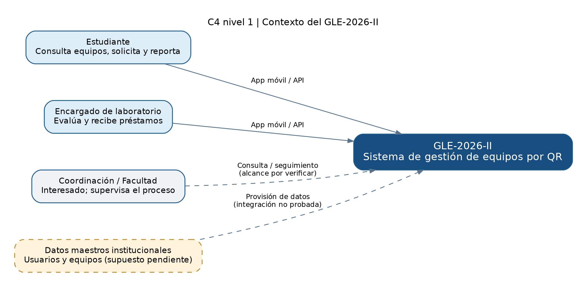
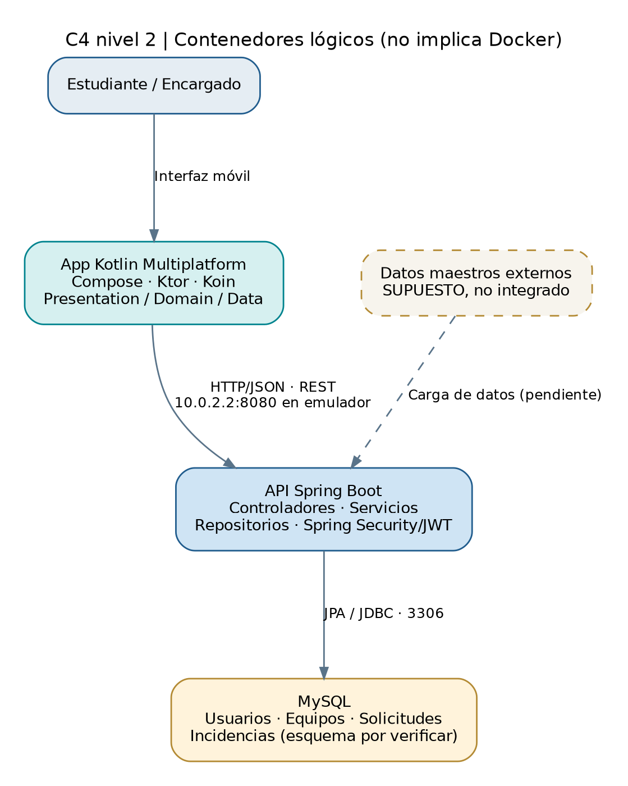
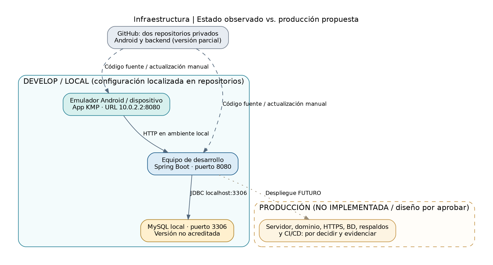
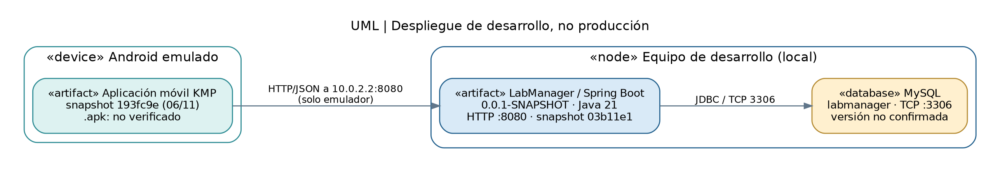
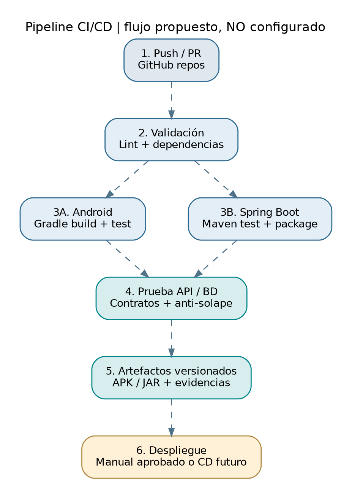

# DOCUMENTO DE ARQUITECTURA - GLE-2026-II

**Universidad Peruana Unión · Ingeniería de Software I · Unidad III · Sesión 3**

**Equipo N.°:** POR CONFIRMAR  
**Integrantes:** Marec, Williams, Diego e Iván  
**Arquitecto (propuesta):** Marec - por confirmar  
**Versión:** 0.9 · 09/11/2026  
**Estado:** Borrador pendiente de validación

# 0. Control del documento

| Versión | Fecha | Responsable | Cambio |

|---|---|---|---|

| 0.1 | 26/10/2026 | Equipo / Sesión 1 | Base de alcance OpenUP; RF-01 a RF-07 y riesgos R1-R6. |

| 0.2 | 02/11/2026 | Equipo / Sesión 2 | Seguimiento E1: frontend parcial y restricciones reconocidas. |

| 0.9 | 09/11/2026 | Arquitecto propuesto | Documento de arquitectura basado en Charter, matrices y código fuente; pendiente validación. |

Propósito. Registrar la arquitectura efectivamente identificada del GLE-2026-II, las decisiones técnicas y el plan de verificación. Las etiquetas ACTUAL, PROPUESTO y PENDIENTE distinguen hechos de objetivos; ningún caso de prueba se presenta como aprobado sin evidencia de ejecución.

> **Advertencia sobre la línea base** El backend publicado fue señalado por el equipo como desactualizado. Las capturas de GitHub reflejan el estado localizado al 09/11/2026, no el código actualizado que reside en el equipo de un compañero. La solución documentada se debe revisar tras su sincronización.

# A1. Roles y matriz RACI

Asignación provisional basada en el reparto visible del Sprint Backlog. El equipo debe confirmar roles principal y secundario antes del envío; una persona puede desempeñar varios roles OpenUP.

| Integrante | Rol principal (propuesto) | Rol secundario / evidencia | Responsabilidad |

|---|---|---|---|

| Marec | Arquitecto | Desarrollador móvil (catálogo, QR) | Cuaderno, diagramas, ADR y arquitectura KMP. |

| Williams | Desarrollador backend | DevOps provisional (setup, auth, anti-solape) | API, seguridad, implementación y proceso de build. |

| Diego | Tester | Diseño de datos / historial | Pruebas y esquema SQL, trazabilidad de datos. |

| Iván | Analista | Jefe de proyecto provisional (a validar) | Visión, backlog, coordinación y riesgos. |

| Coordinación de laboratorios | Interesado | Aprobador externo | Validación de objetivos y alcance. |

RACI: R ejecuta; A responde por el entregable (exactamente una A por fila); C consultado; I informado. Las letras representan roles, no una asignación irrevocable a personas.

| Producto de trabajo | Interes. | Analista | Arquitecto | Dev. | Tester | Jefe proy. |

|---|---|---|---|---|---|---|

| Visión y alcance | C | A/R | C | I | I | C |

| Backlog / lista de ítems | C | A | C | R | C | I |

| Cuaderno y ADR | I | C | A/R | R | C | I |

| Infraestructura y pipeline | I | I | C | A/R | C | I |

| Build e implementación | I | I | C | A/R | C | I |

| Casos y log de pruebas | I | C | C | R | A/R | I |

| Plan de iteración | I | C | C | C | C | A/R |

| Lista de riesgos | C | R | C | C | C | A |

La matriz se basa en los seis roles OpenUP pedidos por el profesor. La designación de Iván como jefe de proyecto y Marec como arquitecto es una propuesta editorial, no un nombramiento acreditado.

# A2. Objetivos, supuestos, restricciones y pila

| Tipo | Descripción |

|---|---|

| Objetivo O1 | Asegurar que un equipo no tenga préstamos aceptados o en uso superpuestos, incluso con solicitudes concurrentes. |

| Objetivo O2 | Permitir a estudiante y encargado consultar, solicitar, aprobar, rechazar y registrar devoluciones con trazabilidad. |

| Objetivo O3 | Mantener separación entre presentación móvil, reglas de negocio, API REST y persistencia para facilitar pruebas y evolución. |

| Restricción C1 | MVP operativo del Charter: no se incluye reserva de ambientes ni alta/CRUD administrativo de equipos o usuarios desde la app. |

| Restricción C2 | Cliente Android con cámara; backend Java/Spring Boot y base de datos MySQL; soporte multiplataforma iOS existe en el código, pero no está validado en pruebas. |

| Restricción C3 | Semestre 2026-II y cuatro integrantes; no se ha acreditado servidor ni infraestructura de producción. |

| Supuesto S1 | Los registros maestros de equipos y usuarios provienen de una BD o integración externa; provisión no probada. |

| Supuesto S2 | Acceso a equipos Android y ambiente local para pruebas del QR, permisos y conectividad. |

La tabla reporta la versión LOCALIZADA en código; no cambia dependencias ni afirma soporte vigente donde no se ha comprobado. Las fechas de soporte se contrastan con fuentes públicas listadas al final.

| Capa / artefacto | Versión verificada en repositorio | Fin de soporte conocido / acción |

|---|---|---|

| Móvil (Kotlin) | 2.1.0 (`libs.versions.toml`) | Fin de soporte 2.1 no publicado de forma comparable; la política de 18 meses aplica desde Kotlin 2.4. Evaluar actualización. |

| Compose Multiplatform | 1.7.1 (`libs.versions.toml`) | Fecha EOL oficial no especificada; revisar releases y compatibilidad. |

| Ktor cliente | 2.3.12 (`libs.versions.toml`) | Versión publicada 20/06/2024; sin fecha EOL oficial fija. Ktor 3.6.1: 30/10/2026; planificar migración. |

| Koin DI | 4.0.0 (`libs.versions.toml`) | No consta fecha EOL oficial; verificar soporte/compatibilidad. |

| Android AGP / API | AGP 8.7.0; minSdk 24; targetSdk 35 | No consta fecha EOL de AGP; REQ-16 pide minSdk 26, pero Gradle declara 24. |

| Backend Spring Boot | 3.2.5 (`pom.xml`) | Último lanzamiento OSS 3.2.x: 21/11/2024; ya sin soporte OSS. Actualización pendiente. |

| Java | 21 (`pom.xml`) | Oracle JDK 21: Premier hasta 09/2028; Extended hasta 09/2031 (sujeto a licencia). |

| MySQL | Motor identificado; versión local sin acreditar | Versión sin acreditar. MySQL 8.0: Extended terminó 04/2026; 8.4 LTS: Premier 04/2029, Extended 04/2032. |

| Infraestructura / CI | Local; sin workflow en repos publicados | EOL no aplica: pipeline y entorno NO implementados. |

> **Compatibilidad pendiente de resolver** El backlog y la Matriz_Entregable usan diferentes numeraciones REQ; las evidencias A3 y A8 preservan los RF-01 a RF-07 del Project Charter como línea base y citan REQ-xx indicando el archivo de origen.

# A3. Requisitos arquitectónicamente significativos

Se conservan los ID RF del Charter / Sesión 1 y los riesgos R1-R6. Los ADR propuestos se registran sin sustituir automáticamente requisitos o pruebas existentes.

| ID | Requisito y efecto arquitectónico | Riesgo S1 | Decisión |

|---|---|---|---|

| RF-01 | Controlar login y permisos según rol en servidor; JWT, autorización, contrato de respuesta. | R5 | ADR-004 |

| RF-02 | Identificar por QR y consultar disponibilidad real; cámara + API. | R2 | ADR-002 |

| RF-03 / RF-04 | Crear solicitud con justificación y evitar aceptación superpuesta bajo concurrencia. | R1 | ADR-003 |

| RF-05 | Aprobación/rechazo restringidos al encargado responsable. | R5 | ADR-004 |

| RF-06 | Registrar devolución, identidad y estado físico final de manera consistente. | R4 | ADR-001/003 |

| RF-07 | Reportar incidencias ligadas a equipo/préstamo sin depender de la UI únicamente. | R4 / R6 | ADR-001 |

Requisito no funcional adicional: `REQ-15` de Matriz_Entregable fija una respuesta inferior a 1.500 ms en el catálogo; su prueba no figura ejecutada. `REQ-16` de esa misma matriz exige Android API 26, mientras el repositorio declara mínimo 24: queda como divergencia por corregir.

# A4. Escenarios de atributos de calidad

| ID / atributo | Fuente y estímulo; entorno | Respuesta esperada | Medida / prueba |

|---|---|---|---|

| SC-01 · Integridad | Dos solicitudes simultáneas del mismo equipo/intervalo; backend+MySQL local. | A lo sumo una queda aceptada; conflicto registrado. | 0 solapes en 100 intentos; CP-05 (pendiente). |

| SC-02 · Exactitud QR | Estudiante escanea QR válido o inválido en Android con cámara. | Se consulta el ID en API; pantalla muestra el equipo correcto o error. | 20 QR válidos + 5 inválidos, 0 mapeos incorrectos; CP-03 y CP-07 propuesto. |

| SC-03 · Seguridad | Estudiante autenticado intenta aprobar una solicitud en la API. | Backend rechaza por rol; no altera estado. | HTTP 403, 0 cambios; CP-08 propuesto. |

| SC-04 · Trazabilidad | Encargado registra devolución con estado físico. | Persisten usuario, marcas de tiempo y estado final. | 100% de 20 devoluciones con campos completos; CP-10 propuesto. |

| SC-05 · Rendimiento | Usuario consulta catálogo en desarrollo con 20 repeticiones. | Backend responde lista sin timeout. | p95 < 1.500 ms; CP-09 propuesto (criterio de REQ-15). |

Las mediciones son objetivos de aceptación, no resultados observados. En Matriz_Entregable, CP-01 a CP-06 figuran con “Estado: Pendiente” pese a que la columna “Resultado obtenido” dice “Éxito”; no es evidencia suficiente para aprobarlos.

# A5. Vistas de arquitectura

Convención: cajas azules/verdes = elementos identificados en repositorio; cajas y flechas discontinuas = supuestos / propuestas / componentes no verificados. Los diagramas y sus fuentes Graphviz (`.dot`) se entregan junto al PDF. El documento SIMCLIN sirve como guía de contenido, no como arquitectura copiada.

## 5.1. Contexto del sistema (C4 nivel 1)

*Figura. Actores, GLE y la dependencia de datos maestros por confirmar. Fuente editable: `diagramas/contexto.dot`.*

El estudiante y el encargado operan el cliente móvil; la coordinación de laboratorios es interesada del Charter. El origen externo de usuarios/equipos se mantiene como supuesto porque no se ha acreditado la integración.

## 5.2. Contenedores lógicos (C4 nivel 2)

*Figura. Aplicación KMP, API Spring Boot y MySQL. Fuente editable: `diagramas/contenedores.dot`.*

La app usa `presentation/domain/data`, Ktor y Koin; el backend publicado es un servicio Spring Boot por capas, no microservicios. Ambos se relacionan mediante JSON/HTTP. La URL 10.0.2.2 es solo la ruta del emulador Android al host local.

## 5.3. Infraestructura y ambientes

*Figura. Desarrollo local observado y ausencia de producción evidenciada. Fuente editable: `diagramas/infraestructura.dot`.*

No hay pruebas de VMs, Proxmox, red VLAN ni servidores desplegados; no se inventan esos componentes. Para producción se requieren definición formal de infraestructura, HTTPS, políticas de secretos, respaldo, dominio, monitoreo y responsable de operaciones.

## 5.4. Vista de despliegue UML

*Figura. Artefactos versionados en nodos de desarrollo, con protocolos y puertos. Fuente editable: `diagramas/despliegue.dot`.*

Versión y nodo: aplicación móvil = snapshot Android `193fc9e` (sin APK acreditado); API = Maven `0.0.1-SNAPSHOT`, Spring Boot 3.2.5, Java 21, snapshot backend `03b11e1`; base de datos = MySQL local `labmanager` (versión no acreditada). Desarrollo usa HTTP :8080 y JDBC :3306; el emulador se conecta por 10.0.2.2.

## 5.5. Pipeline CI/CD

*Figura. Diseño de pipeline candidato: sin workflows publicados. Fuente editable: `diagramas/pipeline.dot`.*

El diagrama es una propuesta, no una automatización ya operativa. Debe configurarse por repositorio en `.github/workflows/`, con `./gradlew` para Android y `./mvnw` para Spring Boot, ejecución de pruebas, análisis de secretos y artefactos. El despliegue exige infraestructura confirmada; por ahora no se promete CD a producción.

# A6. Decisiones de arquitectura (ADR)

| ADR | Decisión / estado | Alternativa descartada | Razón principal |

|---|---|---|---|

| ADR-001 | App KMP / Spring Boot / MySQL; adoptada como base | Flutter, cliente Android exclusivo, microservicios | Reutilizar código real y controlar complejidad. |

| ADR-002 | CameraX y consulta a API; propuesta | Aplicación externa o disponibilidad incrustada en QR | Consulta actual y cámara integrada. |

| ADR-003 | Bloqueo transaccional para anti-solape; propuesta | Validación solo UI o consulta sin bloqueo | Consistencia cuando hay concurrencia. |

| ADR-004 | JWT y autorización en servidor; parcial | Solo ocultar acciones en la interfaz | Evitar cambios no autorizados. |

## 6.1. ADR completo resumido: ADR-003 anti-solape

Contexto. RF-04 exige no aceptar préstamos superpuestos; el backlog 017 (Sprint 2, en progreso) propone un trigger en MySQL. El backend público aún no acredita transacciones ni una prueba concurrente que verifique la regla.

Decisión propuesta. En una transacción del backend, serializar operaciones por equipo (bloqueo de registro/estrategia equivalente), revalidar intervalos y estados antes de confirmar, devolver HTTP 409 ante conflicto y cubrirlo con un test de 100 intentos. Si se conserva el trigger MySQL propuesto, verificar que el conjunto trigger+transacción es seguro bajo concurrencia real.

Alternativas. Validar solo en Android se descarta por carrera entre clientes; consulta simple sin bloqueo se descarta por TOCTOU; lock Redis se descarta por complejidad adicional de infraestructura.

Consecuencias positivas. Regla centralizada para todos los clientes y prueba repetible. Negativas. Mayor contención bajo carga, necesidad de tratar deadlocks y dependencias de MySQL; el mecanismo exacto queda sujeto al backend actualizado.

Estado. Propuesto, no implementado/verificado al corte del documento. Archivo completo `docs/adr/0003-bloqueo-antisolape.md`. Los otros tres ADR completos están en Markdown con contexto, decisión, alternativas y consecuencias.

# A7. Mecanismos e interfaces críticas

| Mecanismo / interfaz | Decisión técnica y evidencia | ADR / estado |

|---|---|---|

| Persistencia | JPA + MySQL; entidades `Usuario`, `Equipo`, `SolicitudPrestamo` y `TicketIncidencia` identificadas. Versionar migraciones/SQL y transacciones. | 001/003 · parcial |

| Autenticación | Spring Security + JWT + BCrypt; aplicación guarda sesión; falta contrato común y pruebas por rol. | 004 · parcial |

| Autorización | No basta `authenticated()`: validar ENCARGADO en operaciones sensibles dentro de API. | 004 · pendiente |

| QR / integración | ID estable en QR, CameraX Android y consulta API. Integración con datos maestros externa no probada. | 002 · pendiente |

| Observabilidad | Retirar logs de token/hash y secretos; añadir logs estructurados y registro de solicitud por ID. | 004 · pendiente |

| Pruebas de datos | Pruebas de concurrencia, estados de devolución, historial aislado; evidencias por caso CP. | 003/004 · pendiente |

| Respaldo | Exportaciones y backup con restauración comprobada antes de producción; no hay proceso acreditado. | 001 · propuesto |

## 7.1. Diferencias entre ambientes

| Aspecto | Develop: estado observable | Producción: estado por definir |

|---|---|---|

| Cliente | Android/KMP; URL HTTP `10.0.2.2:8080` para emulador. | HTTPS con host público o LAN autorizada; build firmado. |

| API | Spring Boot local `:8080`; versión pública desactualizada. | Instancia administrada, configuración por entorno, health checks. |

| Datos | JDBC `localhost:3306/labmanager`; ddl-auto=update. | MySQL soportado; migraciones controladas; principio de mínimo privilegio. |

| Credenciales | `application.properties` contiene valores de conexión; revisar exposición de secretos. | Variables/secret manager; rotación, sin hashes/tokens en logs. |

| Pruebas y entrega | Sin workflows CI/CD observados; tests en código no equivalen a ejecución. | Pipeline aprobado, rollback documentado y restauración probada. |

# A8. Riesgos, trazabilidad y verificación

Los riesgos R1-R6 vienen de la Sesión 1. La exposición es estimada P×I (escala 1–5) y no se presenta como medición posterior.

| ID | Riesgo original / exposición | Respuesta de arquitectura |

|---|---|---|

| R1 | Solicitudes simultáneas generan préstamos superpuestos · 20 | Transacción por equipo, prueba CP-05; ADR-003. |

| R2 | QR identifica mal o disponibilidad obsoleta · 16 | API como fuente de verdad, prueba QR; ADR-002. |

| R3 | Datos maestros incompletos / inconsistentes · 16 | Fuente y esquema por definir, validaciones e importación controlada; ADR-001. |

| R4 | Devolución sin trazabilidad final · 15 | Persistencia con usuario/tiempo/estado final; CP-10 propuesto. |

| R5 | Estudiante obtiene permisos de encargado · 15 | Autorización por rol en API, CP-08; ADR-004. |

| R6 | Alcance mayor a capacidad del equipo · 16 | MVP Charter, no extender a gestión administrativa desde el móvil. |

Nuevos riesgos propuestos al corte (sin reutilizar IDs): R7 — contrato de login Android/backend incompatible; R8 — secretos y tokens/hashes expuestos en logs o propiedades; R9 — dependencias sin soporte vigente; R10 — discrepancia minSdk, IDs REQ y definición de “Done”.

## 8.1. Cadenas de trazabilidad

| Riesgo | Requisito / fuente | Escenario | ADR | Prueba |

|---|---|---|---|---|

| R1 | RF-04 / Charter; REQ-11 / Matriz | SC-01 | 003 | CP-05 (pendiente) |

| R2 | RF-02 / Charter; REQ-07 / Matriz | SC-02 | 002 | CP-03; CP-07 prop. |

| R5 | RF-01, RF-05 / Charter | SC-03 | 004 | CP-08 prop. |

| R4 | RF-06 / Charter | SC-04 | 001/003 | CP-10 prop. |

| - | REQ-15 / Matriz | SC-05 | 001 | CP-09 prop. |

## 8.2. Verificación contra el código y fuentes

| Hallazgo | Evidencia concreta | Acción antes de entregar |

|---|---|---|

| Arquitectura móvil KMP y Clean | `shared/src/commonMain/.../data`, `domain`, `presentation`; `settings.gradle.kts`. | Aceptar explícitamente cambio respecto de Charter “Android/Jetpack Compose”. |

| Login incompatible entre snapshots | Cliente exige `AuthResponse(token, user)`; backend devuelve token, nombres, correo, rol. | Comparar con backend actualizado y ejecutar test real. |

| QR aún no funcional | `App.kt` dice “El escáner QR todavía no está implementado”. | Conservar pendiente hasta que funcione con cámara. |

| Configuración sensible | Android registra token en debug; backend registra hash de contraseña; configuración de BD versionada. | Retirar mensajes y secretos; cambiar credenciales comprometidas si aplica. |

| Control de roles incompleto | Backend publicado autentica peticiones, sin prueba de autorización a /responder por rol. | Añadir/validar protección en servicio/endpoint. |

| Compatibilidad Android | Matriz REQ-16: minSdk 26; repositorio: minSdk 24. | Alinear requisito o gradle y anexar evidencia. |

| Fuentes de requisitos no unificadas | Product_Backlog REQ-01 = setup; Matriz_Entregable REQ-01 = BD. | Crear diccionario/crosswalk; evitar confundir códigos. |

| Pruebas no acreditadas | Matriz CP-01..CP-06 estado “Pendiente” aun con “Éxito” anotado. | Adjuntar fecha, entorno, logs, capturas y responsable. |

| Backend informado como desactualizado | Usuario indica nueva versión solo en equipo del compañero. | Revisar nuevos cambios antes de firmar arquitectura. |

| CI/CD no materializado | No `.github/workflows/` en snapshots revisados. | Agregar workflows y pruebas o declararlo proyecto futuro. |

> **Criterio de cierre de Sesión 3** Este PDF y los archivos Graphviz/ADR cumplen la estructura documental, pero no sustituyen evidencia técnica: confirmar equipo y roles, actualizar backend, corregir interfaces, ejecutar CP-05/08, fijar plataforma de producción y revisar versiones soportadas. Estado LCA: NO verificado al corte.

# Fuentes y referencias

- Project Charter GLE-2026-II, archivo entregado por el equipo (versión actualizada).

- Sesión 1 OpenUP: S1_OpenUP_EquipoXX_Documento.pdf, RF-01 a RF-07 y R1-R6.

- Sesión 2 OpenUP: S2_Proyecto_Equipo_PENDIENTE.pdf; corte 02/11/2026.

- Product_Backlog_GLE_Final.xlsx: estimación, priorización, Sprint Backlog, requerimientos.

- Matriz_Entregable.xlsx: requisitos, pruebas, trazabilidad y ADR existentes.

- GitHub Android, snapshot 193fc9e: https://github.com/marecsg/proyecto-android

- GitHub backend, snapshot 03b11e1: https://github.com/marecsg/proyecto-backend (equipo reporta versión pendiente de subir).

- Spring Boot fin de soporte: https://spring.io/support y https://endoflife.date/spring-boot

- Ktor versiones oficiales: https://ktor.io/docs/releases.html

- Oracle MySQL ciclo de vida: https://www.mysql.com/support/eol-notice.html

- Oracle Java SE soporte: https://www.oracle.com/technetwork/java/javase/tech/eol-135779.html

- Kotlin release/support process: https://kotlinlang.org/docs/releases.html
